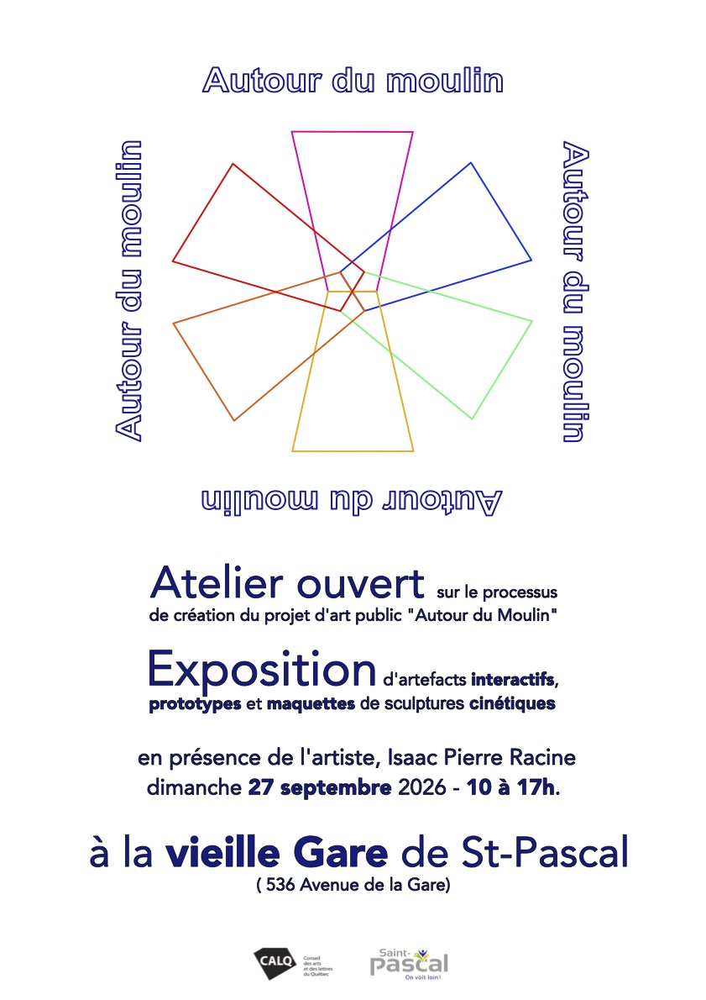

Pour cette dernière séance de médiation je fais équipe avec ma collègue Sarah Brown pour la conception et la  réalisation de l'évènement. Ce sera l'occasion de présenter les trois maquettes de la sculpture ainsi que plusieurs artefacts et d'inviter la communauté locale a exprimer leur appréciation du travail réalisé, d'émettre leur opinion sur les différentes version de sculpture proposées ainsi que sur la pertinence d'une telle initiative. Les données receuillies seront par la suite présentées au conseil municipal en vue du développement des prochaines étapes de réalisation de la sculpture dans sa dimension réelle.  
(Consulter le [questionnaire](questionnaireautourdumoulin.pdf))
